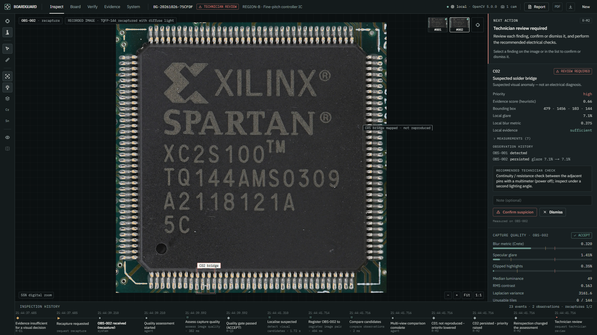
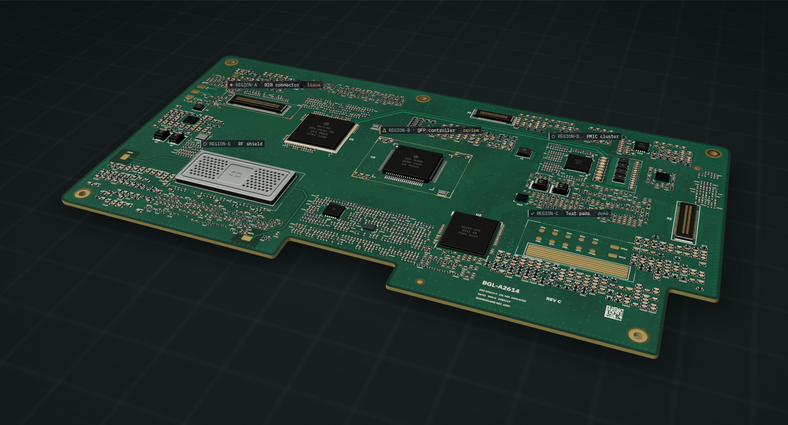
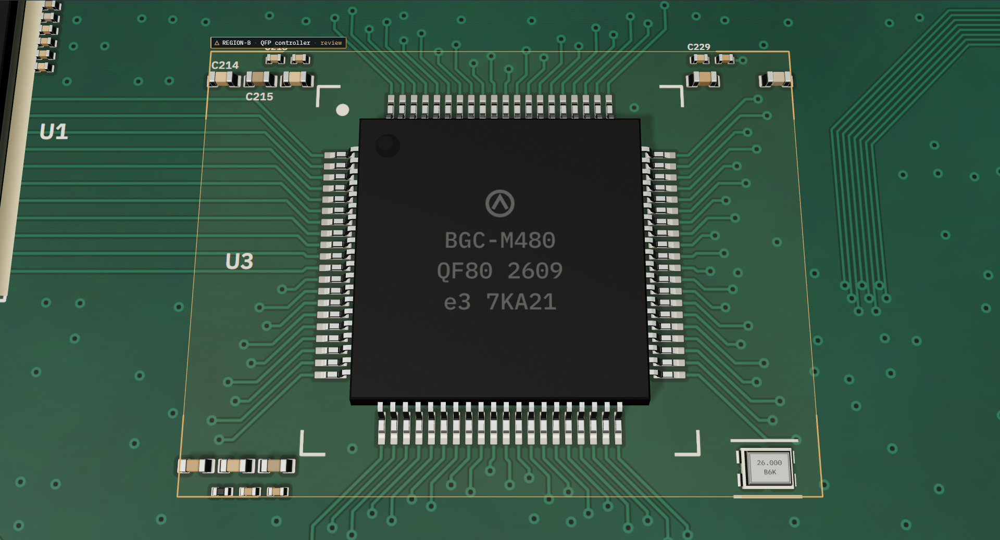
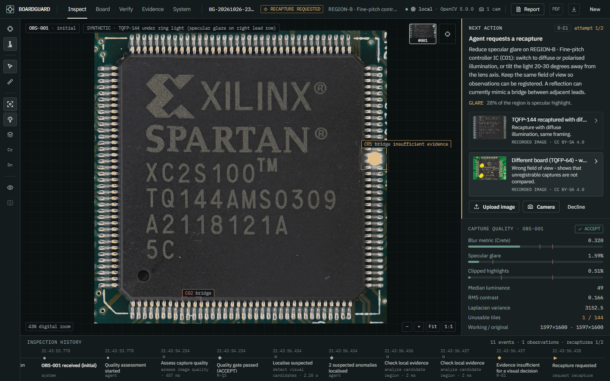
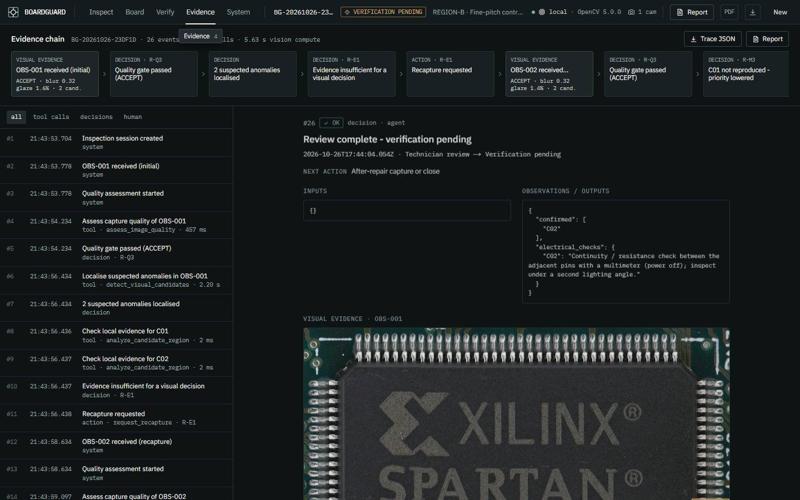
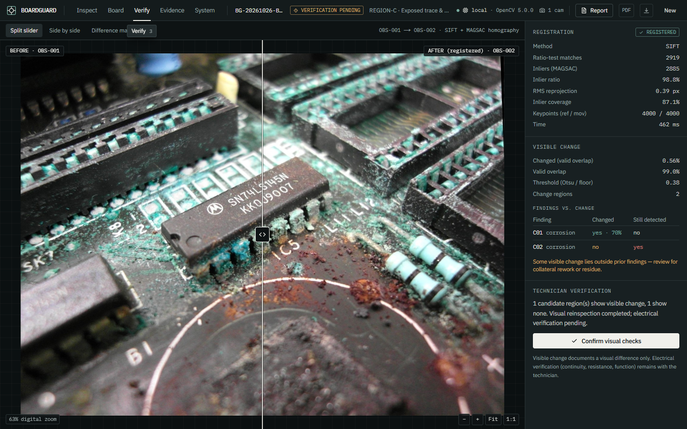
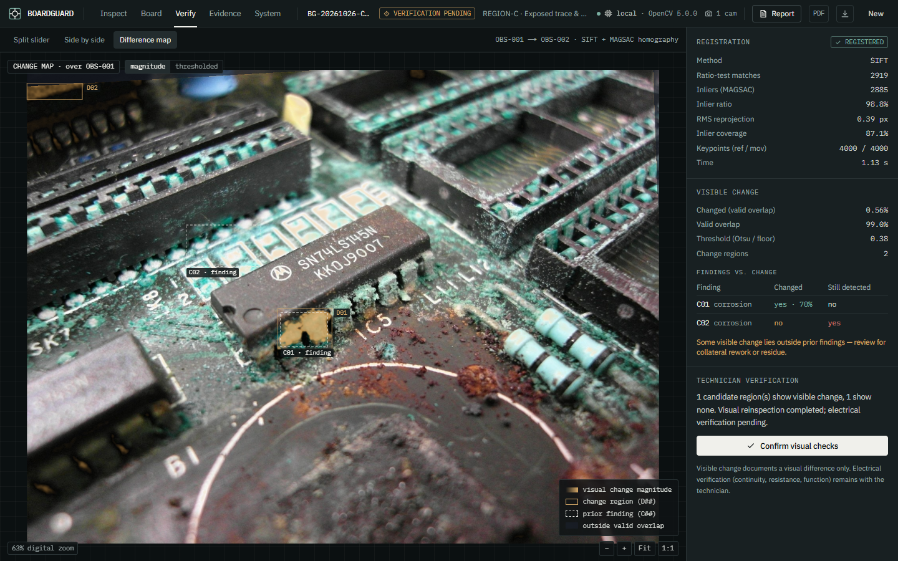
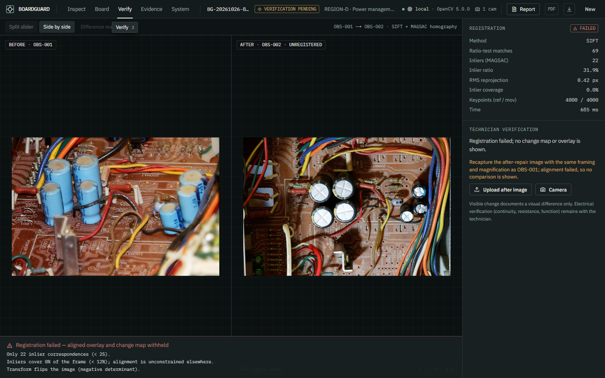
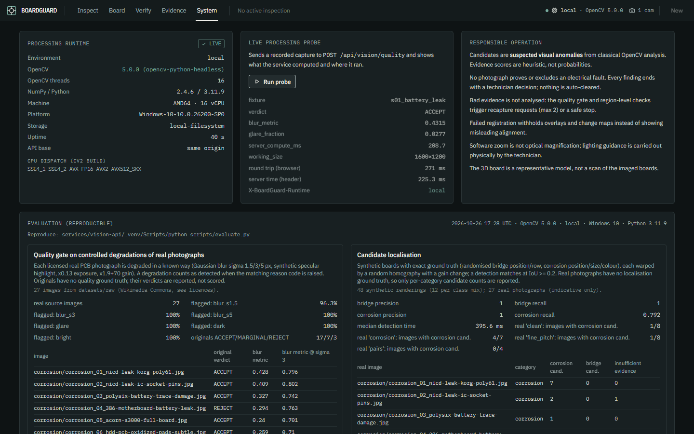

# BoardGuard

**AI-powered microscope assistant for electronics repair.**
*See the damage. Guide the repair. Verify the result.*

BoardGuard turns an ordinary digital microscope into an inspection workstation for
independent repair technicians. OpenCV 5 measures every capture, localises suspected
corrosion and solder bridges, and an inspection agent decides whether the evidence is
good enough. If it isn't, the agent does not guess: it asks for a specific new
observation (diffuse light, refocus, more magnification), registers the new capture
to the old one, re-measures, and records how the assessment changed. Before/after
captures are registered and compared so visible changes after cleaning or rework are
documented. The technician always makes the call, and electrical verification stays
with them.

Built for the [OpenCV AI Competition 2026](https://opencv26.devpost.com/) (Grand Prize, Agentic Vision).



## What is real

| Claim | Status |
|---|---|
| OpenCV version | `opencv-python-headless==5.0.0.93`, asserted at runtime (`cv2.__version__` = 5.0.0) and in the container build |
| Vision processing | Quality (Crete blur metric, Laplacian, Tenengrad, specular mask, exposure, tiles), candidate localisation, SIFT/ORB + USAC MAGSAC registration, shift-tolerant change maps, multi-view comparison — all computed live per request |
| Agent | Policy-driven state machine; vision outputs select the next tool call / recapture request / technician review; every step traced with rule ids and timings |
| Images | 27 licensed Wikimedia Commons photographs (CC0 / PD / CC BY-SA) + clearly labelled synthetic fixtures; see [datasets/README.md](datasets/README.md) |
| 3D board | Representative procedural model for navigation; **not** a scan of the imaged boards |
| AWS | Container + CloudFormation for Lambda (Function URL) + private S3 + CloudWatch are in [`infrastructure/aws`](infrastructure/aws). See the deployment status in [docs/submission/STATUS.md](docs/submission/STATUS.md) |

**Demo video (2:26, real application footage):** [`docs/submission/video/boardguard-demo.mp4`](docs/submission/video/boardguard-demo.mp4) ·
**Sample report:** [`docs/submission/sample-report/`](docs/submission/sample-report) ·
**Status checklist:** [`docs/submission/STATUS.md`](docs/submission/STATUS.md)

| | |
|---|---|
|  |  |
|  |  |
|  |  |
|  |  |

## Key capabilities

* **Inspection workstation** — 3D board → microscope hand-off, zoom/pan/measure, analysis layers (candidates, glare mask, unusable tiles, corrosion cue mask, metallic mask), original-image toggle, live camera / USB microscope capture, uploads.
* **Active visual reinspection** — region-level evidence checks (glare, blur, exposure, lead resolution) trigger targeted recapture instructions; second observations are registered and every earlier finding is classified *persisted*, *not reproduced* or *still inconclusive*.
* **Before/after verification** — split slider, synchronised side-by-side, difference map, registration metrics, findings-vs-change table; overlays are withheld when registration fails.
* **Evidence & trace** — every tool call, decision and human action with inputs, outputs, trigger rule, duration; downloadable JSON trace; printable HTML report and JSON report.
* **System screen** — live runtime identity (OpenCV build, environment, AWS details when deployed), live processing probe, tool contracts, decision rules, thresholds, evaluation results, image licences.

## Judge demo (five built-in scenarios)

| # | Scenario | What it proves |
|---|---|---|
| 01 | Suspected corrosion (real battery-leak photo) | Real CV localisation → technician review |
| 02 | Possible solder bridge under glare (real TQFP + synthetic ring-light glare) | Perception → decision → action: insufficient evidence → recapture request → registration (≈3.9k inliers) → glare suspicion *not reproduced* (priority lowered) while a lint-fibre candidate *persists* (priority raised). Alternate recapture of the wrong board → comparison withheld |
| 03 | Before/after verification (real corrosion + synthetic cleaned fixture) | Registration, change map, findings-vs-change, technician confirmation: "Visual reinspection completed · Electrical verification pending" |
| 04 | Unusable capture (real flash photo) | Quality gate rejects before analysis; declining the recapture stops safely |
| 05 | Real rework pair, different framing | Genuine before/after photos that cannot be registered → overlay withheld |

## Run locally

Requirements: Python 3.11, Node 22, (optional) Docker.

```bash
# 1. Vision API (OpenCV 5)
cd services/vision-api
python -m venv .venv && .venv/Scripts/pip install -r requirements.txt -r requirements-dev.txt   # Linux/macOS: .venv/bin/pip
.venv/Scripts/python -m uvicorn app.main:app --port 8000

# 2. Workstation UI (new terminal)
cd apps/web
npm ci
npm run dev            # http://localhost:3000  (uses NEXT_PUBLIC_API_BASE=http://localhost:8000 from .env.development)
```

Or as one container (UI + API on one port):

```bash
docker build -t boardguard .
docker run --rm -p 8080:8080 boardguard     # http://localhost:8080
```

## Deploy to AWS

Two equivalent paths, both a single CloudFormation stack:

```bash
aws configure          # credentials allowed to create CloudFormation, IAM role, Lambda, S3 (+ ECR for containers)

# A. No Docker: Python 3.12 Lambda zip built from manylinux wheels (OpenCV 5 included)
bash infrastructure/aws/deploy-zip.sh boardguard us-east-1

# B. Container image on ECR (Dockerfile + Lambda Web Adapter)
bash infrastructure/aws/deploy.sh boardguard us-east-1

# Proof: health, runtime identity, a real processing request with timings, CloudWatch lines
bash infrastructure/aws/verify.sh <FunctionUrl> boardguard us-east-1   # writes docs/evaluation/aws-proof.md
```

Resources: Lambda function (3008 MB, 60 s, reserved concurrency 5) serving both the UI and
`/api/*`, public Function URL, private S3 evidence bucket (SSE, public access blocked, 7-day
expiry), CloudWatch log group (14-day retention), least-privilege IAM role; plus a private code
bucket (zip path) or an ECR repository with scan-on-push (container path).

## Environment variables (vision API)

| Variable | Default | Purpose |
|---|---|---|
| `BOARDGUARD_S3_BUCKET` / `BOARDGUARD_S3_PREFIX` | unset / `boardguard/` | Use S3 for captures, artifacts and sessions |
| `BOARDGUARD_DATA_DIR` | `services/vision-api/var/store` | Local storage root |
| `BOARDGUARD_FIXTURES_DIR` | `datasets/fixtures` | Demo fixtures and scenarios |
| `BOARDGUARD_STATIC_DIR` | unset | Serve the exported UI from the API |
| `BOARDGUARD_CORS_ORIGINS` | `http://localhost:3000` | Allowed browser origins |
| `BOARDGUARD_MAX_UPLOAD_BYTES` | 8000000 | Upload cap |
| `BOARDGUARD_RATE_PER_MIN` | 90 | Per-IP POST rate limit |
| `BOARDGUARD_API_KEY` | unset | Require `X-BoardGuard-Key` on POSTs |

## Tests and evaluation

```bash
cd services/vision-api && .venv/Scripts/python -m pytest -q          # 42 unit + API + agent + Lambda-handler tests
.venv/Scripts/python ../../scripts/evaluate.py                       # writes docs/evaluation/results.md
cd apps/web && npx tsc --noEmit && npm run lint && npx next build
BASE_URL=http://localhost:3000 npx playwright test                   # 6 browser scenarios (needs API on :8000 + UI)
```

Results: [docs/evaluation/results.md](docs/evaluation/results.md) (also shown on the System screen).

## Repository layout

```
apps/web/                 Next.js workstation (features/: workspace, board-explorer, microscope, inspections, verification, evidence, system)
services/vision-api/      FastAPI + OpenCV 5 (app/vision, app/agents, app/storage, app/reports, tests)
datasets/                 raw licensed photos + manifest, demo fixtures + scenarios
infrastructure/aws/       CloudFormation template, deploy and verify scripts
scripts/                  make_fixtures.py, evaluate.py
docs/                     architecture, evaluation, submission material
```

## Limitations

* Candidates are **suspected visual anomalies** from classical, hand-calibrated OpenCV analysis.
  Evidence scores are heuristic, not probabilities. No trained defect model is used, because no
  licensed, representative repair dataset with ground truth was available.
* A photograph cannot prove or exclude an electrical fault; BoardGuard never claims continuity or repair success.
* Thresholds were calibrated on 27 public photos and synthetic data — not validated on real repair cases.
* Brown/dark staining and eaten traces are measured but do not raise corrosion candidates (too many false positives on brown boards and copper).
* Homography registration assumes a mostly planar field of view; tall components and large viewpoint changes cause correct refusals (Scenario 05) or parallax-induced change.
* Software zoom is not optical magnification; lighting guidance is executed physically by the technician.
* The demo has no user authentication; technician actions are attributed to an unauthenticated user.

## Licences

Code: MIT (see [LICENSE](LICENSE)). Images: per-file licences in [`datasets/raw/manifest.json`](datasets/raw/manifest.json).
