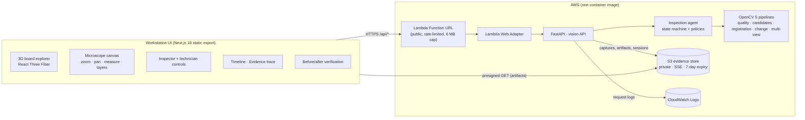
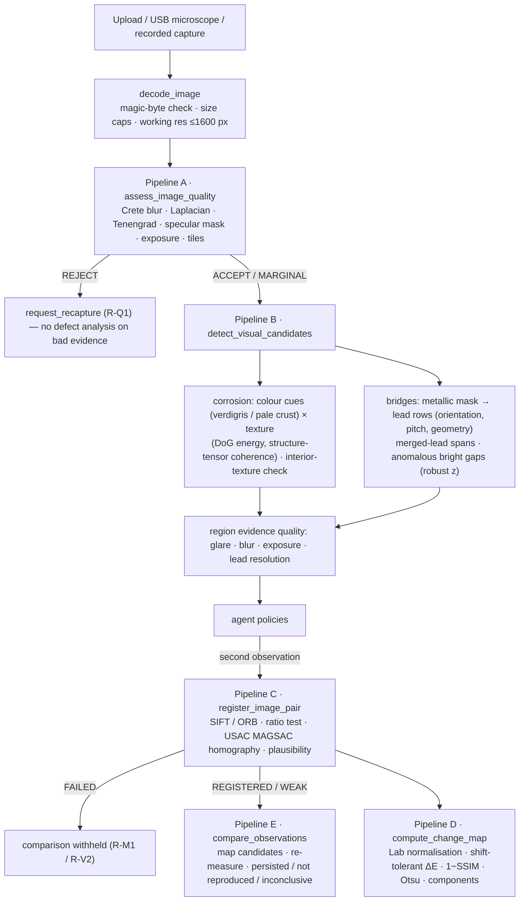
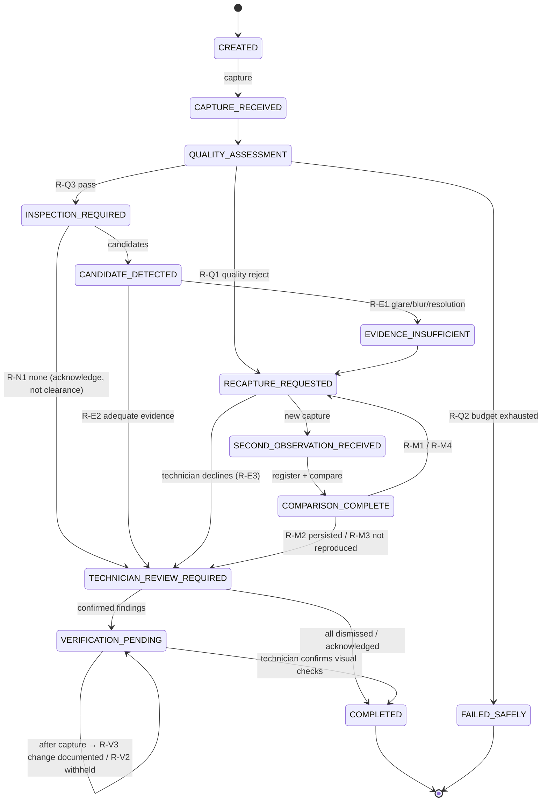

# BoardGuard architecture

## Components

The same image runs locally (`docker run -p 8080:8080`), so the judged
behaviour is identical on a laptop and on AWS. The UI is a static export
served by the same FastAPI app, so a single Function URL serves both.

The live demo runs the same code on **Vercel**: the static export is served
from Vercel's CDN (`public/`) and the FastAPI app (`app/main.py`) runs as one
Python Function via Vercel's zero-config FastAPI support, so the UI again
calls `/api/*` on its own origin (`infrastructure/vercel`).

## OpenCV processing flow

## Agent state machine

Policies are pure functions in `services/vision-api/app/agents/policies.py`;
every transition in the trace cites its rule id. Invariants enforced in code
and tests:

* a capture that fails the quality gate is never analysed for defects;
* no finding is cleared without a technician decision (even "no findings"
  needs acknowledgment);
* a failed registration never yields an overlay or change map;
* at most two agent-requested recaptures per inspection (no loops).

## Tools (explicit contracts, `GET /api/agent/tools`)

`assess_image_quality`, `extract_region_of_interest`, `detect_visual_candidates`,
`analyze_candidate_region`, `register_image_pair`, `compare_observations`,
`compute_change_map`, `request_recapture`, `request_technician_review`,
`record_verification`, `generate_inspection_report`.

## Storage

| Backend | When | Captures / artifacts | Sessions |
|---|---|---|---|
| Local filesystem | development | `services/vision-api/var/store` | JSON files |
| S3 | `BOARDGUARD_S3_BUCKET` set (AWS) | private objects, SSE-S3, served by 1-hour presigned URLs | JSON objects, so any Lambda instance can continue any inspection |
| `/tmp` + Vercel Runtime Cache | `VERCEL` set (live demo) | written to the instance's `/tmp` and mirrored (base64) into the regional Runtime Cache, 24 h TTL; served through `/api/artifacts` | always read from the shared cache first, so any function instance continues any inspection |

The bucket has a lifecycle rule that deletes `boardguard/` objects after 7 days.

## Security boundaries

* No credentials in the frontend; the browser only ever sees presigned artifact URLs.
* Uploads: magic-byte format check (JPEG/PNG/WebP/BMP/TIFF), 8 MB cap (5 MB on AWS),
  decompression-bomb limit (`OPENCV_IO_MAX_IMAGE_PIXELS`), minimum size, storage keys validated
  against a strict pattern (no path traversal); inspection ids validated by regex.
* Abuse limits: per-IP POST rate limit, Lambda reserved concurrency (5), 60 s timeout.
* Optional shared key (`BOARDGUARD_API_KEY` → `X-BoardGuard-Key`) for private deployments.
* IAM role: `s3:GetObject`/`s3:PutObject` on `bucket/boardguard/*` and log writes only.
* Container runs as an unprivileged user.

## Human-in-the-loop controls

Technician actions (`POST /api/inspections/{id}/actions`): confirm/dismiss a finding,
withdraw (undo) a decision while its review is still the current step (rule R-H2; also
when the last dismissal closed the inspection automatically, never after a new capture,
an explicit close or a verification), acknowledge a no-findings result, decline a
recapture, start before/after verification, confirm visual checks, record a
technician-entered electrical measurement, close or stop. Sessions expose
`undoable_decisions`.

Region evidence check (`POST /api/inspections/{id}/region-check` with an observation id and
a rectangle): runs `extract_region_of_interest` plus a lead-row analysis inside the area and
reports glare, focus, exposure and lead resolution. It is recorded in the trace as a
technician-initiated tool call and never changes the agent state or pending action.
The demo has no authentication, so actions are attributed to an "unauthenticated demo user";
no names or signatures are generated.
